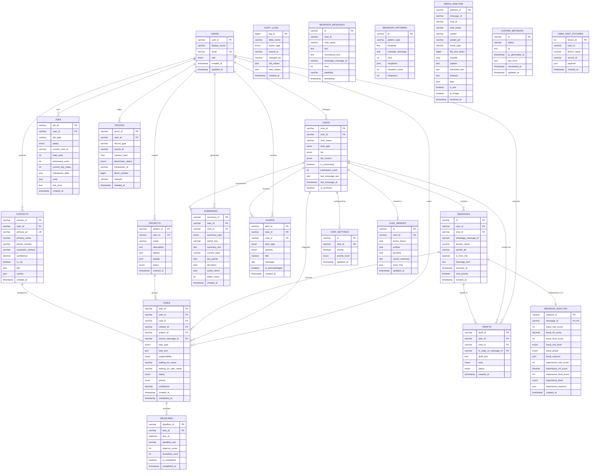

# WAAA Relational Database — Entity-Relationship (ER) Diagram & Normalization Analysis

## 1. Complete Mermaid ER Diagram

---

## 2. Relational Cardinalities & Business Rules

1. **Users $\longleftrightarrow$ Chats ($1 : N$)**: A user owns multiple chats. `ON DELETE RESTRICT` ensures an account cannot be deleted if active conversations are attached.
2. **Chats $\longleftrightarrow$ Messages ($1 : N$)**: A conversation contains many sequential messages. `ON DELETE RESTRICT` guarantees that no WhatsApp communication history can ever be accidentally purged. Chats are instead marked with `is_archived = TRUE`.
3. **Messages $\longleftrightarrow$ Message_Analysis ($1 : 1$)**: Strict 3NF satellite table. Isolates mutable NLP and machine learning scores from immutable WhatsApp message bytes. If a message is explicitly purged, its analysis cascades (`CASCADE`).
4. **Chats/Projects/Contacts $\longleftrightarrow$ Tasks ($1 : N$)**: Tasks originate from conversations, link to an optional project, and are assigned to an optional contact. If a project or contact is deleted, the task remains intact with foreign keys set to `NULL` (`ON DELETE SET NULL`).
5. **Tasks $\longleftrightarrow$ Deadlines ($1 : N$)**: Tasks have deadline reminders and urgency escalation scores ($0$ to $100$). Deleting a task cascades to its deadline records.
6. **Messages $\longleftrightarrow$ Drafts ($1 : N$)**: Multiple draft replies with varying tones (professional, concise, friendly) can be generated for a single message.
7. **Intelligence Records $\longleftrightarrow$ Proofs ($1 : 1$)**: Canonical SHA-256 hashes generated for actions, summaries, and audit checkpoints to detect data tampering.

---

## 3. Database Normalization Decisions (3NF Compliance)

### First Normal Form (1NF):
- Every table has a primary key (`id`, `task_id`, `chat_id`, etc.).
- Attributes contain atomic values. Repeated multi-value collections (such as arbitrary metadata) are stored in validated JSON columns rather than unparsed comma-delimited strings.

### Second Normal Form (2NF):
- All non-key attributes are fully functionally dependent on the entire primary key (no composite primary key partial dependencies).
- For example, `chat_name` and `chat_type` are stored in `chats`, not repeated across `messages`.

### Third Normal Form (3NF):
- Transitive dependencies are removed.
- In the legacy JSON store, each message document embedded `fraudAnalysis` and `importanceAnalysis` sub-objects. These have been normalized into a dedicated `message_analysis` table, ensuring that analysis scores depend directly on the primary key `analysis_id` and the foreign key `message_id`.

---

## 4. Constraint Enforcement Matrix

| Table | Constraint Name | Type | Target / Rule |
| :--- | :--- | :---: | :--- |
| `contacts` | `chk_contacts_confidence` | `CHECK` | `confidence BETWEEN 0.000 AND 1.000` |
| `contacts` | `uk_contacts_jid` | `UNIQUE` | `primary_jid` |
| `messages` | `idx_messages_wa_msg_id` | `INDEX` | `whatsapp_message_id` (indexed for rapid lookups without dropping historical duplicate notify emissions) |
| `message_analysis`| `uk_analysis_message` | `UNIQUE` | `message_id` (enforces exact 1:1 relationship) |
| `deadlines` | `chk_deadlines_urgency` | `CHECK` | `urgency_score BETWEEN 0 AND 100` |
| `tasks` | `chk_tasks_confidence` | `CHECK` | `confidence BETWEEN 0.000 AND 1.000` |
| `chat_memory` | `uk_chat_memory_chat` | `UNIQUE` | `chat_id` |
| `chat_settings`| `uk_chat_settings_chat` | `UNIQUE` | `chat_id` |
| `users` | `uk_users_email` | `UNIQUE` | `email` |
